<div align="center">


# Divix

### Control cambiario para casas de cambio

Compra y venta de divisas, caja por cajero con cortes y billetes,<br/>
precios comparados contra el mercado, estadísticas con pronóstico de demanda y un asistente con IA.

<br/>


[Funcionalidades](#-funcionalidades) ·
[Capturas](#-capturas) ·
[Cómo correrlo](#-cómo-correrlo) ·
[Arquitectura](#-arquitectura) ·
[Equipo](#-equipo)

<br/>

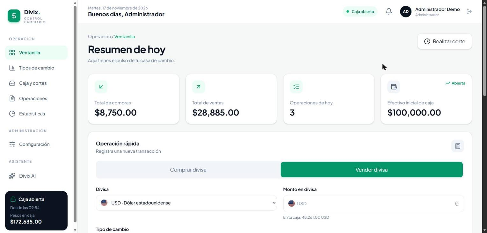

</div>

<br/>

## ✨ Funcionalidades

<table>
<tr>
<td width="50%" valign="top">

### 💱 Ventanilla
Compra o venta en segundos con el tipo de cambio del día y **ticket imprimible** de 80 mm. Antes de registrar, muestra cuánto hay de esa divisa en la caja. En dólares indica qué **billetes** se reciben o se entregan.

</td>
<td width="50%" valign="top">

### 🗄️ Caja y cortes
Apertura con conteo, entradas, salidas y reposición desde la caja fuerte. El **corte** compara lo esperado contra lo contado y marca **faltantes y sobrantes**, también por denominación de billete de USD.

</td>
</tr>
<tr>
<td valign="top">

### 📈 Tipos de cambio y mercado
Precios de compra y venta por divisa, con banderas, comparados contra la **referencia del mercado** (Banxico FIX o Banco Central Europeo). Sugiere precios y **nunca propone uno en pérdida**.

</td>
<td valign="top">

### 📊 Estadísticas y pronóstico
Indicadores y gráficas por periodo, desempeño por cajero y horario con más movimiento. Un **pronóstico de demanda** por divisa, con un modelo de temporadas y tendencia que mide su propio error.

</td>
</tr>
<tr>
<td valign="top">

### 🤖 Divix AI
Asistente que responde preguntas del negocio con los **datos reales**, por ejemplo "¿cuánto debo tener de cada divisa en mi caja?". Funciona con DeepSeek o Claude de Anthropic.

</td>
<td valign="top">

### 🔔 Avisos y seguridad
La campana avisa si la caja está cerrada o si un precio quedó en pérdida. Hay roles de **administrador** y **cajero** con sesión JWT. Todo se valida en el servidor: **no se puede operar sin caja abierta ni vender más de lo que hay**.

</td>
</tr>
<tr>
<td valign="top">

### 📋 Operaciones
Historial completo con búsqueda por folio o cajero y filtros por tipo, divisa y fecha.

</td>
<td valign="top">

### ⚙️ Configuración y perfil
Usuarios, divisas (con sugerencias del catálogo mundial **ISO 4217**) y datos del negocio para los tickets. Cada quien tiene su **perfil** con foto y cambio de contraseña.

</td>
</tr>
</table>

<br/>

## 📸 Capturas

<table>
<tr>
<td width="50%">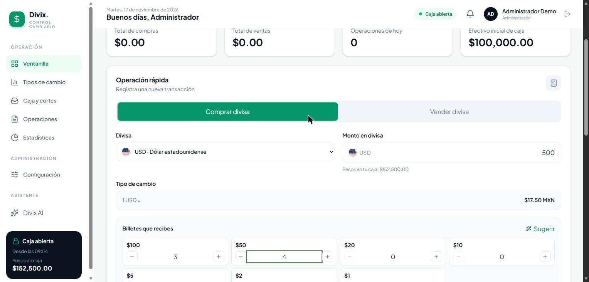</td>
<td width="50%">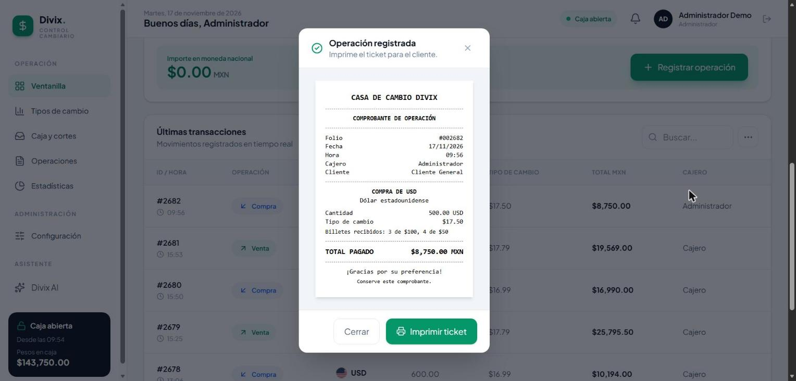</td>
</tr>
<tr>
<td align="center"><b>Compra de USD</b> con el detalle de billetes</td>
<td align="center"><b>Ticket</b> listo para imprimir</td>
</tr>
<tr>
<td>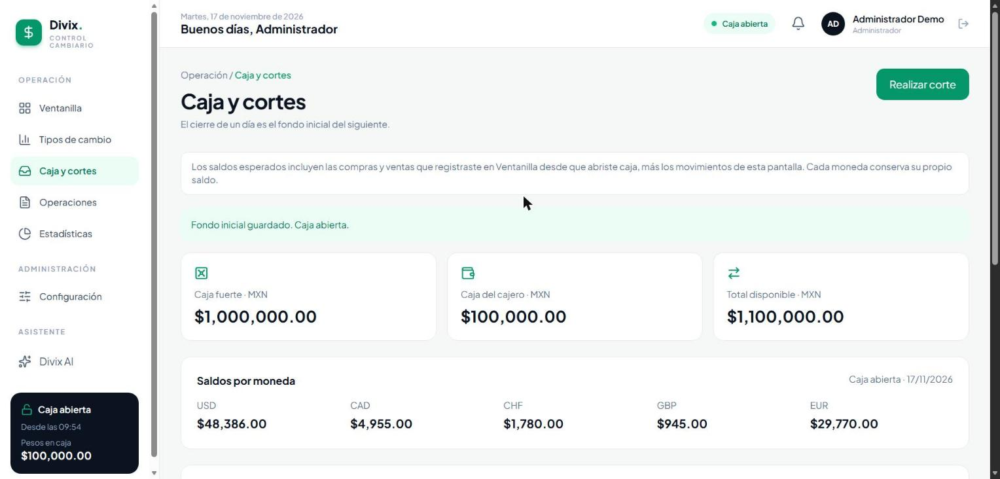</td>
<td>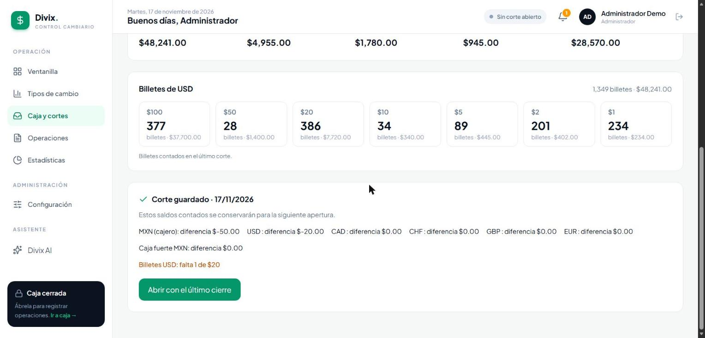</td>
</tr>
<tr>
<td align="center"><b>Caja abierta</b> con saldos por divisa</td>
<td align="center"><b>Corte</b> con faltantes y sobrantes</td>
</tr>
<tr>
<td>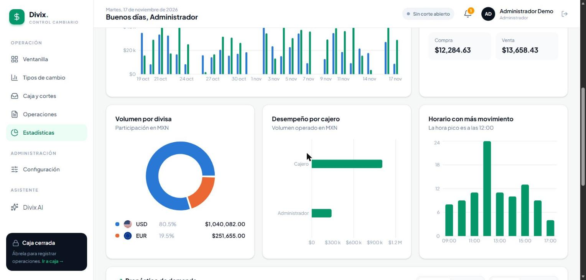</td>
<td>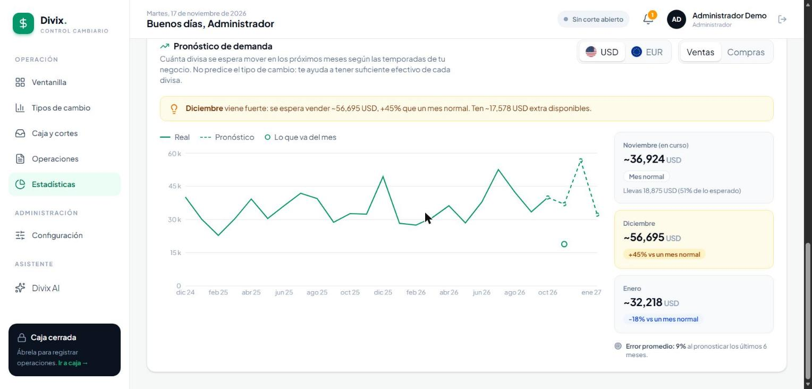</td>
</tr>
<tr>
<td align="center"><b>Estadísticas</b> por divisa, cajero y horario</td>
<td align="center"><b>Pronóstico de demanda</b> con su error medido</td>
</tr>
<tr>
<td>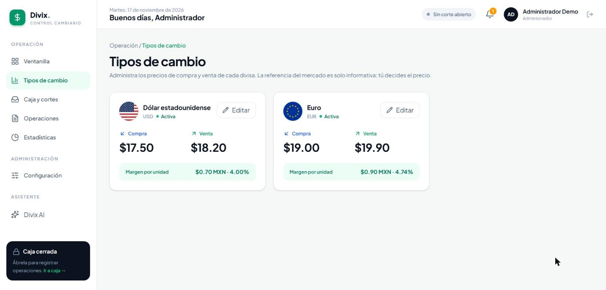</td>
<td>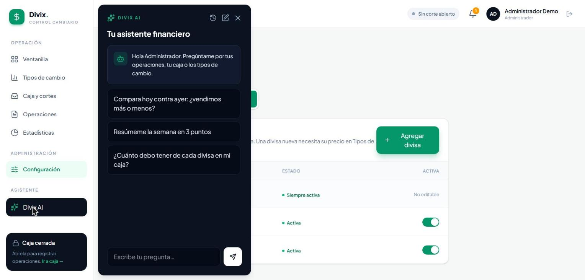</td>
</tr>
<tr>
<td align="center"><b>Tipos de cambio</b> con su margen</td>
<td align="center"><b>Divix AI</b>, el asistente del negocio</td>
</tr>
</table>

<details>
<summary><b>Ver más capturas</b></summary>
<br/>

| | |
|:---:|:---:|
| 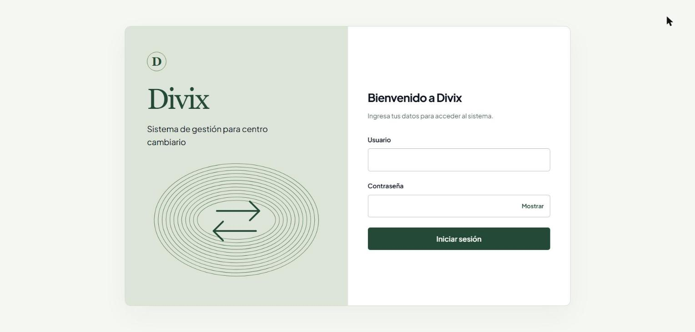 | 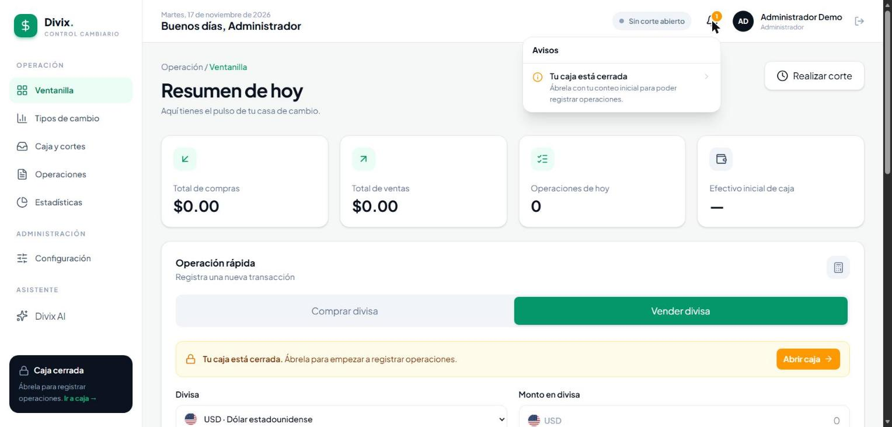 |
| Inicio de sesión | Campana de avisos |
| 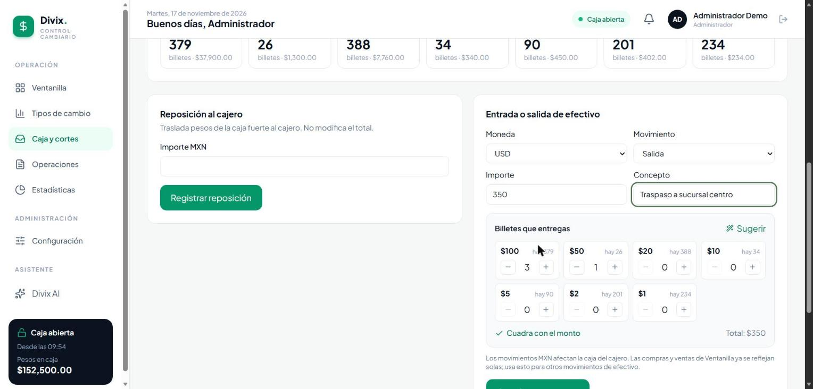 | 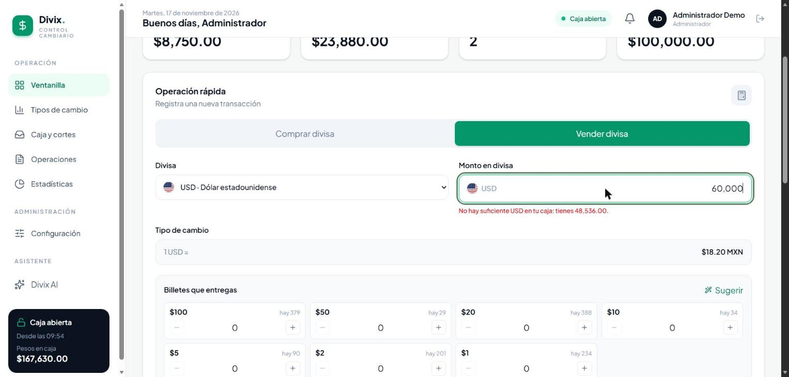 |
| Salida de USD por denominación | Validación de saldo en Ventanilla |
| 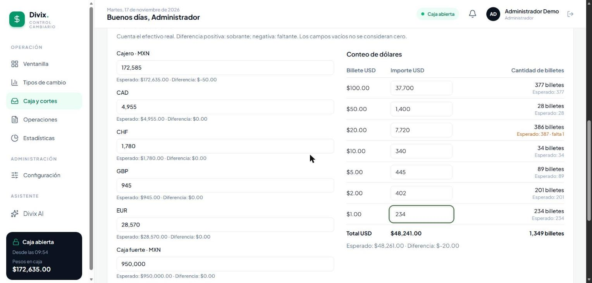 | 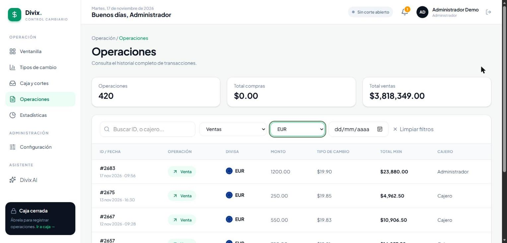 |
| Conteo del corte de cierre | Historial de operaciones con filtros |
| 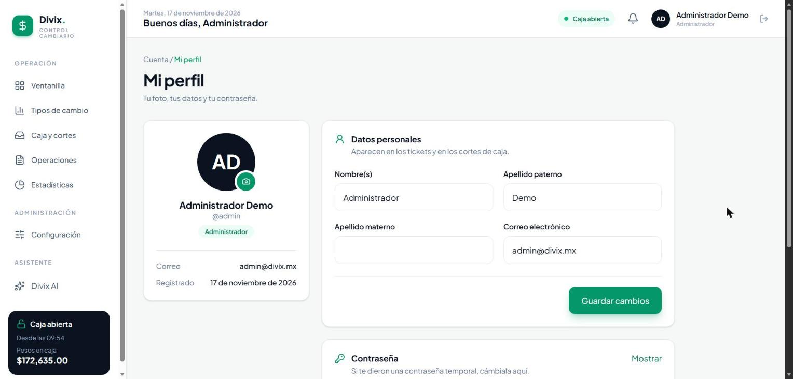 | 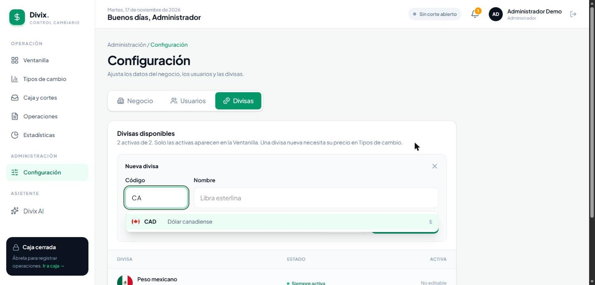 |
| Mi perfil | Nueva divisa con catálogo ISO 4217 |

</details>

> 📖 El **recorrido completo**, paso a paso y con las 36 capturas, está en [docs/funcionalidades](docs/funcionalidades/README.md).

<br/>

## 🚀 Cómo correrlo

**Requisitos:** Node.js 20.19 o más reciente (recomendado 22) y npm. No necesitas instalar una base de datos: por defecto usa una base JSON local.

```bash
# 1. Clonar
git clone https://github.com/raulchvzt/Divix.git
cd Divix

# 2. Instalar todo (raíz, backend y frontend)
npm run instalar

# 3. Variables de entorno (una sola vez)
cp backend/.env.example backend/.env      # edita backend/.env y pon un JWT_SECRET
cp frontend/.env.example frontend/.env

# 4. Levantar backend y frontend juntos
npm run dev
```

| | |
|---|---|
| 🖥️ **Aplicación** | http://localhost:5173 |
| 🔌 **API** | http://localhost:3000 |
| 👤 **Usuarios de prueba** | `admin` (administrador) y `cajero1` (cajero), con la contraseña de `SEED_PASSWORD` en `backend/.env` |

> 💡 **Windows:** en lugar de `cp` usa `copy backend\.env.example backend\.env` o copia los archivos desde el explorador.
>
> 💡 **Después de un `git pull`:** reinicia `npm run dev` para que el backend cargue los cambios.

### Comandos

| Comando | Qué hace |
|---|---|
| `npm run instalar` | Instala las dependencias de la raíz, el backend y el frontend |
| `npm run dev` | Levanta backend y frontend al mismo tiempo |
| `npm run dev:backend` / `npm run dev:frontend` | Solo una de las dos partes |
| `npm run build` | Compila los dos |
| `npm run lint` | Revisa el código de los dos |

### Base de datos

| Modo | Cómo | Para qué |
|---|---|---|
| **JSON** | `DB_DRIVER=json` | Desarrollo y demos. Guarda todo en `backend/data/` y al arrancar crea los usuarios de prueba, USD y EUR con su tipo de cambio y **2 años de operaciones ficticias** (`SEED_DEMO=false` para no generarlas). Para empezar de cero, borra la carpeta. |
| **MySQL** | `DB_DRIVER=mysql` y las variables `DB_*` | Producción. Los cambios de estructura están en `backend/sql/` y se ejecutan a mano, en orden de fecha. |

### Opcionales

- **Divix AI:** pon `IA_PROVEEDOR` y la clave de DeepSeek o Anthropic en `backend/.env`. Sin clave, el asistente avisa que no está configurado.
- **Referencia del mercado:** con `BANXICO_TOKEN` usa el FIX de Banxico. Sin token usa el Banco Central Europeo.

<br/>

## 🏗️ Arquitectura

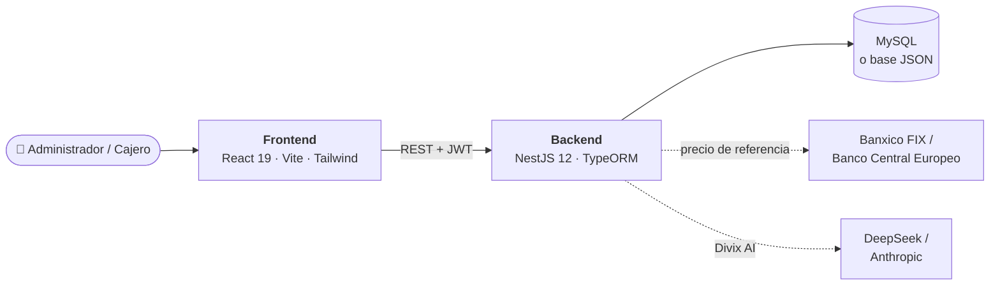

```
Divix/
├── backend/            API en NestJS (TypeScript)
│   ├── src/modules/    Rutas por área: operaciones, caja, tipos de cambio, IA…
│   ├── src/services/   Lógica del negocio
│   ├── src/entities/   Tablas (TypeORM)
│   └── sql/            Cambios de estructura para MySQL
├── frontend/           Aplicación web en React
│   └── src/pages/      Una pantalla por módulo
└── docs/               Recorrido de funcionalidades con capturas
```

**Decisiones clave**

- 💰 **Dinero sin errores de redondeo.** Los importes viajan como texto y se calculan con `decimal.js`, sin perder centavos.
- 🛡️ **El servidor valida todo.** Usa DTO con `class-validator` y roles en cada ruta. La caja abierta y el saldo suficiente se revisan en el backend, no solo en la pantalla.
- 🔁 **Sesión que se renueva sola.** El token de acceso dura 15 minutos y el de renovación 7 días.
- 🧪 **Base JSON intercambiable con MySQL.** Permite desarrollar y presentar sin instalar nada.

Detalle técnico de cada parte en [backend/README.md](backend/README.md) (rutas, variables, reglas) y [frontend/README.md](frontend/README.md) (pantallas y permisos).

<br/>

## 🤝 Cómo trabajamos

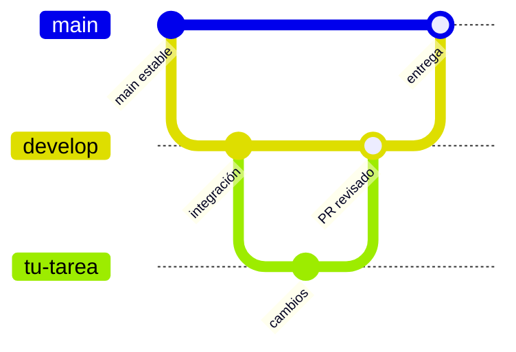

1. Actualiza `develop` y crea tu rama desde ahí: `git checkout develop && git pull && git checkout -b tu-nombre-tarea`.
2. Haz tus cambios. Pueden tocar `backend/` y `frontend/` en el mismo PR.
3. Antes de subir, corre `npm run lint`.
4. Abre un Pull Request hacia `develop`, pide revisión y haz merge.
5. Cuando `develop` esté probado, se pasa a `main` con otro PR.

Los archivos `.env` **no se suben** a GitHub: cada quien tiene el suyo.

<br/>

## 👥 Equipo

<table>
<tr>
<td align="center" width="33%">
<a href="https://github.com/raulchvzt"></a><br/>
<b>Raul Alejandro</b><br/>
<a href="https://github.com/raulchvzt">@raulchvzt</a>
</td>
<td align="center" width="33%">
<a href="https://github.com/oswald1x"></a><br/>
<b>Angel Oswaldo Cervantes Arreguin</b><br/>
<a href="https://github.com/oswald1x">@oswald1x</a>
</td>
<td align="center" width="33%">
<a href="https://github.com/iGlitchlol"></a><br/>
<b>Jonathan Joshua</b><br/>
<a href="https://github.com/iGlitchlol">@iGlitchlol</a>
</td>
</tr>
</table>

<br/>

<details>
<summary><b>Historia del repositorio</b></summary>
<br/>

Este repositorio une los antiguos `divix-backend` y `divix-frontend` y conserva todos sus commits y autores. El historial de cada parte se ve con `git log -- backend/` o `git log -- frontend/`.

</details>
